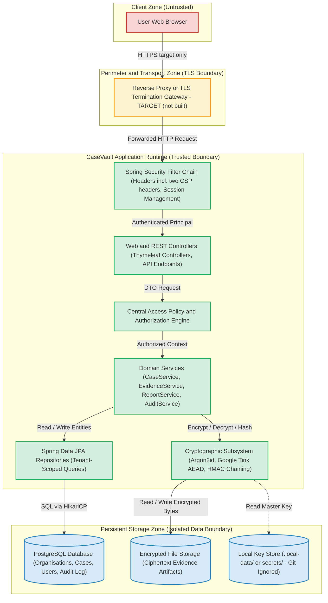

# System Architecture: CaseVault

## 1. Architectural Overview
CaseVault is structured as a modular layered monolith built on Java 21 LTS and Spring Boot 3.5.x. It enforces defense-in-depth principles across web presentation, application services, domain business logic, cryptographic subsystems, and persistent data tiers.

---

## 2. Component Architecture & Trust Boundaries

> **As built vs target.** Built: browser to application over plain HTTP, the Spring Security filter chain, controllers, access policy, services, Argon2id / Tink / HMAC, PostgreSQL (prod-like profile; the default and local profiles use in-memory H2), encrypted evidence files and a file-based key store. **TARGET (not built in this submission):** the "Reverse Proxy or TLS Termination Gateway" node and the HTTPS hop in front of it. There is no TLS configuration, nginx or compose file in the repository. See [known-limitations.md](assurance/known-limitations.md).

---

## 3. Subsystem Breakdown

### 3.1 Web & Presentation Tier
- **Thymeleaf Engine**: Server-rendered HTML utilizing strict contextual escaping (`th:text`). Prohibits raw unescaped fragments (`th:utext`) and direct DOM manipulation.
- **Security Headers & CSP**: Emits the strict `Content-Security-Policy` as two headers (`script-src 'self'`, no nonce, no inline script or style allowed), `X-Frame-Options: DENY`, `X-Content-Type-Options: nosniff`, and `Permissions-Policy`.
- **Session Management**: Server-side HTTP sessions with session cookie flags (`HttpOnly`, `SameSite=Strict`, `Secure`). Session ID rotates upon login.

### 3.2 Service & Access Control Tier
- **AccessPolicy Enforcement**: Service layer validates that the authenticated principal's `organisation_id` matches the target entity's `organisation_id`. Any cross-tenant or unauthorized entity request throws `ResourceNotFoundException` yielding HTTP 404.
- **Separation of Duties**:
  - `AUDITOR_ADMIN` restricted from case and evidence access.
  - `MANAGER` cannot approve self-authored reports (Four-Eyes Principle).

### 3.3 Cryptographic Tier
- **Argon2id (Passwords)**: Spring Security `Argon2PasswordEncoder` with BouncyCastle (`memory=65536`, `iterations=3`, `parallelism=1`).
- **Google Tink (Evidence at Rest)**: AES-256-GCM authenticated encryption (Tink AEAD) of each evidence file; there is no key hierarchy. The keyset is stored as cleartext JSON beside the data (documented residual risk). Raw evidence is encrypted in memory before disk write.
- **HMAC-SHA256 (Audit Chain)**: Monotonically chained audit logs where each row hashes previous hash + current payload + actor + millisecond-truncated timestamp.

### 3.4 Data & Persistence Tier
- **PostgreSQL**: Production-grade RDBMS with Flyway schema migration tracking.
- **Parameterised JPA Queries**: Prevents SQL injection across all search and query paths.
- **Testcontainers & H2**: Testcontainers PostgreSQL instance ensures production-identical database testing, while H2 supports lightweight unit tests.

---

## 4. Compliance & Standards Mapping
- **OWASP Top 10**:
  - OWASP Top 10:2025 [VERIFY MANUALLY]: A01 (Broken Access Control), A02 (Cryptographic Failures), A05 (Security Misconfiguration)
  - OWASP Top 10:2021: A01:2021, A02:2021, A05:2021
- **CWE**: CWE-284, CWE-311, CWE-693, CWE-1021
- **ASVS 5.0**: V1 Architecture, V4 Access Control, V14 Configuration [VERIFY MANUALLY]
