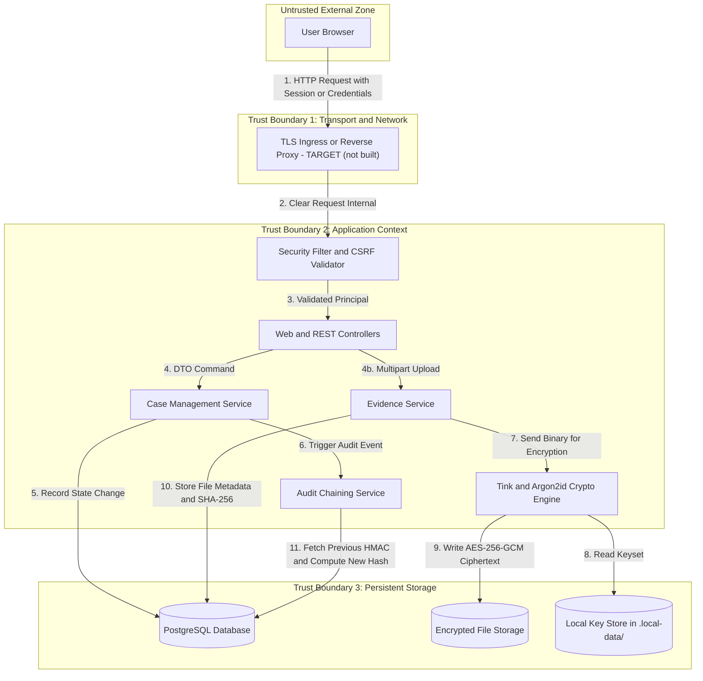
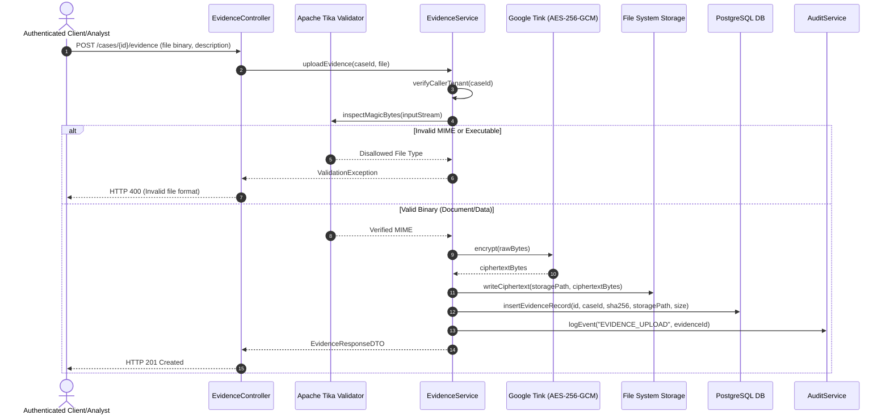
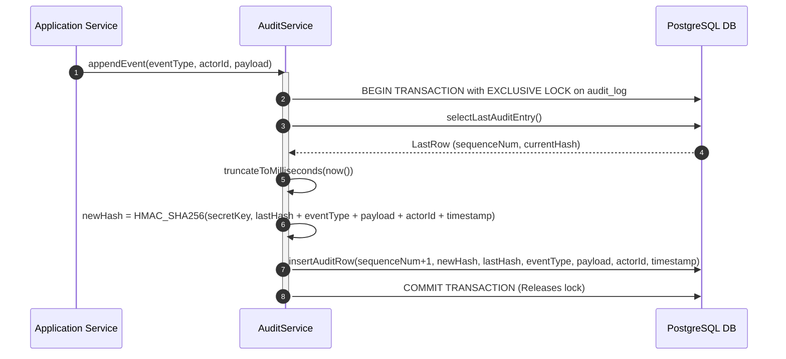

# Data Flow Specification: CaseVault

## 1. Overview
This document models data movement across CaseVault's trust boundaries during key operations: authentication, case management, evidence upload/encryption, evidence download/decryption, and audit logging.

---

## 2. Global Data Flow Diagram (DFD)

> **As built vs target.** The "TLS Ingress or Reverse Proxy" node (Trust Boundary 1) is a **TARGET (not built in this submission)**: the application is reached over plain HTTP. All other nodes exist in the code. The key store is a file next to the data, not a separate service. See [known-limitations.md](assurance/known-limitations.md).



---

## 3. Sequence Flows Across Boundaries

### 3.1 Authentication & Session Issuance Flow

```mermaid
sequenceDiagram
    autonumber
    actor User as User Browser
    participant Sec as Security Filter
    participant Auth as AuthService
    participant Hash as Argon2id Engine
    participant DB as PostgreSQL DB
    participant Audit as AuditService

    User->>Sec: POST /login (username, password, CSRF)
    Sec->>Auth: authenticate(username, password)
    Auth->>DB: findByUsername(username)
    DB-->>Auth: UserRecord (hash, salt, attempts, lockedUntil)
    Auth->>Hash: verify(rawPassword, storedHash)
    Hash-->>Auth: boolean isValid
    alt Valid Credentials & Account Not Locked
        Auth->>DB: resetFailedAttempts(userId)
        Auth->>Audit: logEvent("AUTH_LOGIN_SUCCESS", userId)
        Auth-->>Sec: AuthenticationSuccess
        Sec-->>User: Set-Cookie (JSESSIONID; HttpOnly; SameSite=Strict; Secure)
    else Invalid Credentials or Locked
        Auth->>DB: incrementFailedAttempts(userId)
        Auth->>Audit: logEvent("AUTH_LOGIN_FAILURE", username)
        Auth-->>Sec: AuthenticationException
        Sec-->>User: HTTP 401 (Generic error message; uniform timing)
    end
```

---

### 3.2 Evidence Upload & Encryption Flow (Tink AES-256-GCM AEAD)



---

### 3.3 Evidence Secure Streaming Download Flow

```mermaid
sequenceDiagram
    autonumber
    actor User as Authorized User
    participant Ctrl as EvidenceController
    participant Svc as EvidenceService
    participant DB as PostgreSQL DB
    participant Disk as File System Storage
    participant Tink as Google Tink (AES-256-GCM)
    participant Audit as AuditService

    User->>Ctrl: GET /cases/{caseId}/evidence/{evidenceId}/download
    Ctrl->>Svc: getEvidence(caseId, evidenceId)
    Svc->>DB: findEvidenceByIdAndTenant(evidenceId, callerOrgId)
    alt Record Not Found or Foreign Tenant
        DB-->>Svc: empty()
        Svc-->>Ctrl: ResourceNotFoundException
        Ctrl-->>User: HTTP 404 Not Found
    else Record Found
        DB-->>Svc: EvidenceMetadata
        Svc->>Disk: readCiphertext(storagePath)
        Disk-->>Svc: ciphertextBytes
        Svc->>Tink: decrypt(ciphertextBytes)
        Tink-->>Svc: plaintextBytes
        Svc->>Audit: logEvent("EVIDENCE_DOWNLOAD", evidenceId)
        Svc-->>Ctrl: StreamingResponseBody (plaintextBytes)
        Ctrl-->>User: HTTP 200 (Content-Disposition: attachment; filename=safe)
    end
```

---

### 3.4 Cryptographic Audit Log Chaining Flow



---

## 4. Compliance & Standards Mapping
- **OWASP Top 10**:
  - OWASP Top 10:2025 [VERIFY MANUALLY]: A01 (Broken Access Control), A02 (Cryptographic Failures), A04 (Insecure Design), A08 (Integrity Failures)
  - OWASP Top 10:2021: A01:2021, A02:2021, A04:2021, A08:2021
- **CWE**: CWE-284, CWE-311, CWE-353, CWE-434
- **ASVS 5.0**: V2 Authentication, V4 Access Control, V6 Cryptography, V7 Logging, V12 File Handling [VERIFY MANUALLY]
