# Threat Model: CaseVault Platform

## 1. System Overview & Architectural Assumptions
CaseVault is a multi-tenant case-management and digital evidence platform designed for a fictional incident response consultancy. It processes sensitive forensic materials across multiple enterprise client organisations.

The system comprises:
- An untrusted client-side browser tier.
- An edge transport boundary (TLS termination / reverse proxy). **Built in the Docker stack (Phase 12B):** nginx terminates TLS (`deploy/compose.yaml`); outside that stack the application serves plain HTTP.
- A hardened Spring Boot 3.5.x application runtime executing within a non-root container (built: non-root user in the `Dockerfile`; no compose file or runtime hardening exists).
- Persistent storage tiers consisting of a PostgreSQL 16 database and an encrypted evidence filesystem.

---

## 2. Assets Inventory & Classification

| Asset ID | Asset Name | Description | Sensitivity | Primary Security Objectives |
|---|---|---|---|---|
| **A-01** | Digital Evidence Artifacts | Raw disk images, packet captures, memory dumps, forensic logs | Restricted | Confidentiality, Integrity, Non-Repudiation |
| **A-02** | Investigation Notes & Remediation | Analyst case notes, containment steps, vulnerability root causes | Confidential | Confidentiality, Integrity |
| **A-03** | Final Incident Reports | Formal sanitized reports provided to client executive leadership | Confidential | Integrity, Authenticity, Confidentiality |
| **A-04** | User Credentials & Passwords | Argon2id password hashes, salts, lockout states, user identifiers | Critical | Confidentiality, Integrity |
| **A-05** | Cryptographic Keys & Keyset | Google Tink AES-256 keyset, audit HMAC signing key | Critical | Confidentiality, Integrity, Availability |
| **A-06** | Audit Trail Records | Monotonically chained HMAC-SHA256 security event logs | Critical | Integrity, Authenticity, Non-Repudiation |
| **A-07** | Client Metadata & Tenant Registry | Case metadata, organisation profiles, analyst assignments | Confidential | Confidentiality, Integrity |
| **A-08** | Application Execution Runtime | JVM memory, process space, filesystem, container sandbox | High | Integrity, Availability |

---

## 3. Threat Actors & Capabilities

| Actor ID | Actor Profile | Description & Capability | Motivation |
|---|---|---|---|
| **TA-01** | External Anonymous Attacker | Remote adversary on public internet with access to public endpoints (`/login`, `/actuator/health`) | Credential harvesting, server exploitation, denial of service |
| **TA-02** | Compromised Client Account | Legitimate client user whose account credentials were stolen or phished | Espionage on competitor cases, data exfiltration, privilege escalation |
| **TA-03** | Malicious Low-Privilege Analyst | Insider investigator with valid credentials to assigned cases | Unauthorized data harvesting, evidence tampering, sabotage |
| **TA-04** | Rogue Manager | Privileged consultancy manager seeking to bypass dual-control | Fraudulent report approval, concealing investigative deficiencies |
| **TA-05** | Rogue Auditor-Administrator | Platform administrator with user management and audit log access | Unauthorized surveillance of case evidence, covering up administrative abuse |
| **TA-06** | Database / Storage Operator | Privileged infrastructure operator with direct DBMS or disk snapshot access | Mass data exfiltration, offline password cracking, evidence theft |

---

## 4. Trust Boundaries

> **As built vs target.** Built: TB-2 (Spring Boot application with filter chain, services, Argon2id, Tink AES-256-GCM, HMAC chain), TB-3 (PostgreSQL in the prod-like profile, in-memory H2 otherwise; encrypted evidence files; file-based key store) and the non-root user of TB-4. **Built in Phase 12B (Docker stack only):** the TB-1 nginx ingress with TLS (self-signed certificate) and the TB-4 runtime hardening (read-only root filesystem, dropped capabilities, resource limits; evidence in `docs/evidence/deploy/`). **TARGET (not built):** a certificate authority certificate, TLS between nginx and the application, and anything outside the one-host Docker stack. See [known-limitations.md](assurance/known-limitations.md).

```
[ Browser / Client Machine (Untrusted) ]
====================== Trust Boundary 1 (TB-1: Network / Transport) ======================
[ Ingress / TLS Reverse Proxy / Gateway ]   <-- nginx in deploy/compose.yaml (Phase 12B, self-signed certificate)
====================== Trust Boundary 2 (TB-2: Application Perimeter) ====================
[ CaseVault Spring Boot Application Runtime (JVM) ]
  ├── Web Security Filter Chain (Authentication, CSP and other headers, Session Fixation)
  ├── Service Layer (AccessPolicy, Tenancy Validation, Four-Eyes Rule)
  └── Cryptographic Subsystem (Google Tink AES-256-GCM AEAD, HMAC Chaining)
====================== Trust Boundary 3 (TB-3: Data Storage & Persistence) ==============
[ PostgreSQL Database ]  &  [ Encrypted Evidence Storage (Disk) ]
====================== Trust Boundary 4 (TB-4: Host & Container Boundary) =============
[ Docker Container Runtime / Host OS ]
```

### Trust Boundary Definitions:
- **TB-1 (Network / Transport Boundary)**: Boundary separating untrusted internet clients from the application ingress.
  - *Threats*: Eavesdropping, credential sniffing, session hijacking, replay attacks.
- **TB-2 (Application Perimeter Boundary)**: Boundary separating untrusted HTTP request parameters from internal application services.
  - *Threats*: Injection (SQLi, XSS), Broken Object-Level Authorization (BOLA/IDOR), path traversal, parameter tampering.
- **TB-3 (Data Storage & Persistence Boundary)**: Boundary separating application logic from persistent database tables and disk storage.
  - *Threats*: Direct SQL manipulation, offline volume snapshot inspection, audit log tampering.
- **TB-4 (Host & Container Boundary)**: Boundary separating the containerized JVM process from the host kernel.
  - *Threats*: Container breakout, privilege escalation, unmanaged host resource consumption.

---

## 5. STRIDE Threat Analysis by Boundary

| Boundary | STRIDE Category | Threat Description | Affected Assets | Countermeasure & Security Requirement |
|---|---|---|---|---|
| **TB-1** | **Spoofing** | Attacker impersonates legitimate user via brute force or session hijacking | A-04, A-07 | Argon2id hashing, lockout after 5 failures, SameSite=Strict, Secure cookies, session rotation (SR-03, SR-04, SR-05) |
| **TB-1** | **Tampering** | Man-in-the-Middle intercepts and modifies requests in flight | All | Built in the Docker stack (Phase 12B): TLS 1.2/1.3 at nginx (TLS 1.3 negotiated by default, weak ciphers refused; `docs/evidence/deploy/05-tls.txt`) with a self-signed certificate, and the HSTS header written by the application (`04-headers.txt`). Not built: a certificate from a certificate authority; outside the Docker stack the application has no TLS |
| **TB-1** | **Information Disclosure** | Plaintext credential sniffing or session token interception | A-04, A-05 | Built in the Docker stack: TLS at nginx (self-signed), HttpOnly and Secure cookie flags, strict CSP (SR-05, SR-09) |
| **TB-2** | **Elevation of Privilege** | Low-privilege user invokes administrative or managerial endpoints | A-02, A-03, A-06 | Server-side method security (`@PreAuthorize`), role-based access control re-validated on every request (SR-01) |
| **TB-2** | **Tampering** | Parameter manipulation (IDOR/BOLA) to modify foreign tenant records | A-01, A-02, A-07 | Service-level tenancy check (`organisation_id`), uniform HTTP 404 masking (SR-01, SR-02) |
| **TB-2** | **Repudiation** | Analyst denies deleting evidence or modifying sensitive notes | A-02, A-06 | Cryptographic HMAC-SHA256 audit log capturing actor, event type, and millisecond timestamp (SR-13) |
| **TB-2** | **Information Disclosure** | Server unhandled exceptions leak database schema, class names, or SQL queries | A-08 | Global exception handling with opaque UUID correlation IDs; safe error responses only (SR-15) |
| **TB-2** | **Denial of Service** | Unbounded search queries or credential stuffing saturate JVM threads | A-08 | Query pagination, SQL wildcard escaping, account lockout (SR-04, SR-10) |
| **TB-3** | **Information Disclosure** | Direct physical disk or database snapshot inspection reveals evidence | A-01, A-04 | Evidence encrypted at rest with Google Tink (AES-256-GCM); passwords hashed with Argon2id (SR-03, SR-12) |
| **TB-3** | **Tampering** | Rogue DBA alters audit log rows directly to conceal malicious activity | A-06 | Sequential HMAC-SHA256 hash chaining; breaks verification upon any modified historical row (SR-13, SR-14) |
| **TB-4** | **Elevation of Privilege** | Attacker exploits application bug to gain host root privileges | A-08 | Container runs under unprivileged non-root user (`UID 10001`), read-only root filesystem, all capabilities dropped and `no-new-privileges` set in `deploy/compose.yaml` (`docs/evidence/deploy/02-inspect.txt`) (SR-18) |

---

## 6. Comprehensive Analysis of 11 Mandatory Threat Scenarios

### 1. Cross-Tenant Access
- **Attack Vector**: Attacker from Tenant Alpha changes organisation ID or case UUID in request payload/path to view Tenant Beta records.
- **STRIDE**: Information Disclosure, Tampering.
- **Risk Rating**: **Critical (CVSS 9.2)**
- **Controls**: Service-layer access policy enforces `WHERE case.organisation_id = :sessionOrgId`. If not found or mismatch, throw `ResourceNotFoundException` yielding HTTP 404.
- **Standards Mapping**:
  - OWASP Top 10:2025: A01 (Broken Access Control) [VERIFY MANUALLY] / A01:2021
  - CWE: CWE-284, CWE-200
  - ASVS 5.0: V4.1 [VERIFY MANUALLY]

### 2. Compromised Low-Privilege Account
- **Attack Vector**: Attacker obtains Client credentials and attempts to perform analyst triage, case reassignment, or system configuration.
- **STRIDE**: Elevation of Privilege.
- **Risk Rating**: **High (CVSS 8.1)**
- **Controls**: Spring Security role hierarchy; `@PreAuthorize("hasRole('MANAGER')")` on triage endpoints; no trust placed on client UI controls.
- **Standards Mapping**:
  - OWASP Top 10:2025: A01 (Broken Access Control) [VERIFY MANUALLY] / A01:2021
  - CWE: CWE-285, CWE-269
  - ASVS 5.0: V4.1 [VERIFY MANUALLY]

### 3. ID Manipulation (IDOR / BOLA)
- **Attack Vector**: Attacker alters sequential or guessed UUIDs in `/cases/{id}/notes` or `/evidence/{id}/download`.
- **STRIDE**: Information Disclosure, Tampering.
- **Risk Rating**: **High (CVSS 8.4)**
- **Controls**: High-entropy UUIDv4 identifiers; database query joins tenancy constraint; HTTP 404 returned on unauthorized object lookup.
- **Standards Mapping**:
  - OWASP Top 10:2025: A01 (Broken Access Control) [VERIFY MANUALLY] / A01:2021
  - CWE: CWE-639, CWE-284
  - ASVS 5.0: V4.1 [VERIFY MANUALLY]

### 4. Injection in Notes, Search, and Reports
- **Attack Vector**:
  - *XSS*: Stored payloads (`<script>`, `onerror=`) inserted in case title or notes.
  - *SQLi*: SQL meta-characters injected into case keyword search.
- **STRIDE**: Tampering, Elevation of Privilege.
- **Risk Rating**: **High (CVSS 8.6)**
- **Controls**:
  - Thymeleaf `th:text` (contextual HTML encoding) strictly enforced; `th:utext` prohibited.
  - Strict Content Security Policy (two headers, `script-src 'self'`, no nonce; templates contain no inline script).
  - Parameterised JPA queries and SQL `LIKE` wildcard escaping (`%`, `_`).
- **Standards Mapping**:
  - OWASP Top 10:2025: A03 (Injection) [VERIFY MANUALLY] / A03:2021
  - CWE: CWE-79, CWE-89
  - ASVS 5.0: V5.2, V5.3 [VERIFY MANUALLY]

### 5. Disguised Uploads
- **Attack Vector**: Attacker renames malicious executable (`malware.exe`, `shell.php`) to `incident_log.jpg` or uploads an SVG containing malicious JavaScript.
- **STRIDE**: Elevation of Privilege, Tampering.
- **Risk Rating**: **Critical (CVSS 9.0)**
- **Controls**:
  - Apache Tika magic-byte binary stream inspection (rejects mismatched content-types).
  - Executable extensions and SVG completely blocked.
  - Files stored outside web root with encrypted payloads (Google Tink) and served with `Content-Disposition: attachment`.
  - Synthetic data only in tests; AV scanning stub integrated.
- **Standards Mapping**:
  - OWASP Top 10:2025: A04 (Insecure Design) [VERIFY MANUALLY] / A04:2021
  - CWE: CWE-434, CWE-350
  - ASVS 5.0: V12.1 [VERIFY MANUALLY]

### 6. Credential & Secret Exposure
- **Attack Vector**: Hardcoded keys, passwords in Git commits, secrets printed in log files or leaked to browser storage.
- **STRIDE**: Information Disclosure.
- **Risk Rating**: **Critical (CVSS 9.5)**
- **Controls**:
  - First-run bootstrap generates keys into git-ignored `.local-data/` or `secrets/`.
  - Pre-commit secret filter and Gitleaks CI scanning on full history.
  - Sensitive fields excluded from `toString()`, JSON serializers, and Logback output.
- **Standards Mapping**:
  - OWASP Top 10:2025: A07 (Identification and Authentication Failures) [VERIFY MANUALLY] / A07:2021
  - CWE: CWE-798, CWE-259
  - ASVS 5.0: V14.1 [VERIFY MANUALLY]

### 7. Vulnerable Dependencies
- **Attack Vector**: Outdated third-party libraries containing known remote code execution or deserialization CVEs.
- **STRIDE**: Elevation of Privilege, Information Disclosure.
- **Risk Rating**: **High (CVSS 7.8)**
- **Controls**:
  - Maven Enforcer `dependencyConvergence` and duplicate dependency ban.
  - CI Trivy scanner (`--severity CRITICAL,HIGH --exit-code 1`).
  - Dependabot automated weekly pull requests.
- **Standards Mapping**:
  - OWASP Top 10:2025: A06 (Vulnerable and Outdated Components) [VERIFY MANUALLY] / A06:2021
  - CWE: CWE-1395, CWE-1104
  - ASVS 5.0: V14.2 [VERIFY MANUALLY]

### 8. Audit Tampering
- **Attack Vector**: Rogue user or DBA modifies, deletes, or inserts historical audit records to hide evidence theft.
- **STRIDE**: Tampering, Repudiation.
- **Risk Rating**: **High (CVSS 8.0)**
- **Controls**:
  - Cryptographic HMAC-SHA256 hash chaining.
  - Transaction-level append locking to ensure monotonic sequence order.
  - Millisecond timestamp truncation for deterministic re-verification.
- **Standards Mapping**:
  - OWASP Top 10:2025: A08 (Software and Data Integrity Failures) [VERIFY MANUALLY] / A08:2021
  - CWE: CWE-353, CWE-365
  - ASVS 5.0: V7.4 [VERIFY MANUALLY]

### 9. Log, Exception & Backup Leakage
- **Attack Vector**: System uncaught exceptions reveal database table names, SQL syntax errors, or stack traces to users.
- **STRIDE**: Information Disclosure.
- **Risk Rating**: **Medium (CVSS 6.5)**
- **Controls**:
  - Global `@ControllerAdvice` sanitizing all error responses into generic messages with opaque UUID correlation IDs.
  - Server banner disabled; database error details suppressed.
- **Standards Mapping**:
  - OWASP Top 10:2025: A05 (Security Misconfiguration) [VERIFY MANUALLY] / A05:2021
  - CWE: CWE-209, CWE-497
  - ASVS 5.0: V7.1 [VERIFY MANUALLY]

### 10. Automated Login, Enumeration & Resource Exhaustion
- **Attack Vector**: High-speed credential stuffing against `/login`; wildcard query flooding (`%`) against `/cases/search`.
- **STRIDE**: Denial of Service, Spoofing.
- **Risk Rating**: **High (CVSS 7.5)**
- **Controls**:
  - Account lockout after 5 consecutive failures with 15-minute cooldown.
  - Generic authentication error messages with uniform timing.
  - Pagination limits and wildcard sanitization on search endpoints.
- **Standards Mapping**:
  - OWASP Top 10:2025: A07 (Identification and Authentication Failures) [VERIFY MANUALLY] / A07:2021
  - CWE: CWE-307, CWE-204
  - ASVS 5.0: V2.2, V11.1 [VERIFY MANUALLY]

### 11. Malicious Insider
- **Attack Vector**:
  - Manager approves own fraudulent report without oversight.
  - Auditor-Admin reads sensitive case evidence files.
- **STRIDE**: Elevation of Privilege, Information Disclosure.
- **Risk Rating**: **High (CVSS 8.5)**
- **Controls**:
  - Enforced Four-Eyes principle: Report author cannot approve the report.
  - Hard role separation: `AUDITOR_ADMIN` denied access to `/cases/**` and `/evidence/**`.
- **Standards Mapping**:
  - OWASP Top 10:2025: A01 (Broken Access Control) [VERIFY MANUALLY] / A01:2021
  - CWE: CWE-284, CWE-269
  - ASVS 5.0: V4.1 [VERIFY MANUALLY]

---

## 7. Attack Paths (Mermaid Flow)

```mermaid
flowchart TD
    subgraph ExternalAttackPaths["External Attack Paths"]
        A1["Attacker on Internet"] -->|Automated Brute Force| B1["/login Endpoint"]
        B1 -->|5 Consecutive Failures| C1["Account Locked (SR-04)"]
        A1 -->|Disguised Upload| B2["/cases/evidence Upload"]
        B2 -->|MIME or Magic Byte Mismatch| C2["Rejected by Apache Tika (SR-11)"]
    end

    subgraph InternalPrivilegePaths["Internal Lateral and Privilege Escalation Paths"]
        U1["Compromised Client User"] -->|Manipulates UUID to Foreign Tenant| B3["/cases/foreign-uuid"]
        B3 -->|Tenant ID Check Mismatch| C3["HTTP 404 Returned (SR-02)"]
        U2["Rogue Manager"] -->|Attempts Self-Approval of Report| B4["/reports/id/approve"]
        B4 -->|authorId equals currentUserId| C4["Blocked by Four-Eyes Rule (SR-06)"]
        U3["Rogue Auditor-Admin"] -->|Direct Request for Case Content| B5["/cases/id"]
        B5 -->|Role Check: AUDITOR_ADMIN Denied| C5["Access Denied / 404 (SR-07)"]
    end

    subgraph PersistenceStoragePaths["Persistence and Storage Attack Paths"]
        DBA["Malicious Database Operator"] -->|Alters Historical Row| B6["audit_log Table"]
        B6 -->|Audit Chain Verification| C6["Cryptographic Break Detected (SR-13)"]
        DBA -->|Copies Evidence Disk Files| B7["/storage/evidence/"]
        B7 -->|Direct Raw Disk Read| C7["Ciphertext Only - Tink AES-256 (SR-12)"]
    end
```



---

## 8. Prioritised Security Controls Matrix

| Priority | Control Category | Implemented Defensive Mechanisms | Addressed Threat IDs |
|---|---|---|---|
| **P1** | Tenant Isolation & Access Enforcement | Server-side `AccessPolicy`, mandatory tenant query scoping, uniform HTTP 404 masking | 1, 2, 3, 11 |
| **P1** | Cryptographic Protection | Argon2id password hashing (64MB, 3 iter), Google Tink AES-256-GCM (AEAD) encryption of evidence files at rest | 4, 6, 10 |
| **P1** | File Upload Hardening | Apache Tika magic-byte inspection, blocked executable/SVG formats, synthetic test fixtures | 5 |
| **P2** | Audit Integrity & Traceability | JDK HMAC-SHA256 chaining, exclusive append lock, deterministic verification | 8, 11 |
| **P2** | Injection Defense | Thymeleaf context encoding (`th:text`), strict CSP (`script-src 'self'`), JPA parameterisation | 4, 10 |
| **P2** | Account Protection | Lockout after 5 failures, timing equalization, SameSite=Strict cookies | 2, 10 |
| **P3** | Safe Error Handling | Global exception interceptor, UUID correlation IDs, zero stack traces | 9 |
| **P3** | Supply Chain & Build Security | CycloneDX SBOM, Trivy vulnerability gating, non-root Docker execution | 7, 18 |
